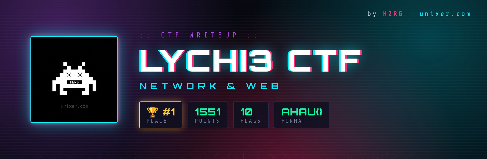
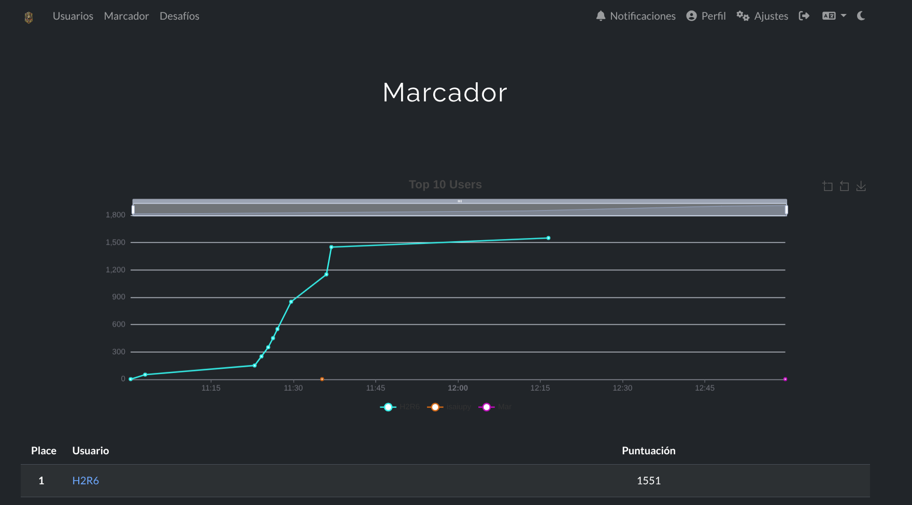

<p align="center">
  
</p>

<p align="center">
  
  
  
  
</p>

<p align="center">
  <b>Writeups detallados de los retos del CTF de <code>Lychi3</code></b><br>
  <sub>reconocimiento · explotación paso a paso · causa raíz · remediación con código</sub>
</p>

---

## 🏆 Resultado final

<p align="center">
  
</p>

<p align="center">
  <b>🥇 1er lugar · H2R6 · 1551 puntos</b>
</p>

---

## 🗺️ Retos

### 🌐 Network

| # | Reto | Pts | Vulnerabilidad | Técnica clave | |
|:-:|---|:-:|---|---|:-:|
| 01 | **File transfer** | `50` | FTP anónimo | `anonymous` login | [**→ ver**](network/file-transfer/README.md) |
| 02 | **Insecure shell** | `100` | Telnet auth bypass · **CVE-2026-24061** | `USER='-f root' telnet -a` | [**→ ver**](network/insecure-shell/README.md) |

### 🕸️ Web

| # | Reto | Pts | Vulnerabilidad | Técnica clave | |
|:-:|---|:-:|---|---|:-:|
| 03 | **SimplePanel** | `100` | SQL Injection | `admin'-- -` | [**→ ver**](web/simplepanel/README.md) |
| 04 | **Development** | `100` | `.git` expuesto | `git-dumper` + historial | [**→ ver**](web/development/README.md) |
| 05 | **Development 2** | `300` | Backup con autoindex | `nginx.conf` filtrado | [**→ ver**](web/development-2/README.md) |
| 06 | **Apuntes** | `100` | Secreto en cookie | `base64 -d` | [**→ ver**](web/apuntes-1/README.md) |
| 07 | **Apuntes 2** | `100` | Cookie tampering | `"admin": true` | [**→ ver**](web/apuntes-2/README.md) |
| 08 | **Apuntes 3** | `100` | IDOR | `/admin/note/1` | [**→ ver**](web/apuntes-3/README.md) |
| 09 | **Apuntes 4** | `300` | Command Injection | `127.0.0.1; ls -la /` | [**→ ver**](web/apuntes-4/README.md) |
| 10 | **Apuntes 5** | `300` | LFI / Path Traversal | `?file=../../../../` | [**→ ver**](web/apuntes-5/README.md) |

<details>
<summary><b>🔗 Cadena de ataque de la serie Apuntes</b></summary>

```text
[Apuntes 1] Cookie Base64 legible ──► flag 1 + estructura de la sesión
      │
      ▼
[Apuntes 2] Cookie sin firma ──► admin:true ──► panel admin + flag 2
      │
      ├──► [Apuntes 3] /admin/note/<id> sin validar dueño ──► IDOR ──► flag 3
      │
      ├──► [Apuntes 4] /admin/tools ──► command injection ──► ls / ──► flag 4
      │                                                         │
      └──► [Apuntes 5] /admin/report?file= ──► LFI ──► app.py + entrypoint.sh ──► flag 5
```

</details>

---

## 📋 Resumen

Casi todas las vulnerabilidades encontradas son **errores de configuración y de validación de entrada**, no fallas complejas:

| Patrón | Retos |
|---|---|
| 🔓 Servicios heredados con valores por defecto inseguros | File transfer, Insecure shell |
| 📦 Artefactos de desarrollo publicados en producción | Development, Development 2 |
| 🍪 Confianza en datos que controla el cliente | Apuntes, Apuntes 2, Apuntes 3 |
| 💉 Input concatenado en SQL, shell y rutas de archivo | SimplePanel, Apuntes 4, Apuntes 5 |

## 🧭 Metodología

```text
 RECON  ──►  ANÁLISIS  ──►  EXPLOTACIÓN  ──►  POST-EXPLOTACIÓN  ──►  REMEDIACIÓN
 nmap        tecnología      curl / bash       código fuente         fix con código
 banners     hipótesis       python            configuración         CWE / OWASP
```

## 🛠️ Herramientas

<p>
  
  
  
  
  
  
  
</p>

## 🏴 Banderas

<details>
<summary><b>⚠️ Spoiler: mostrar las 10 banderas</b></summary>

| Reto | Flag |
|---|---|
| File transfer | `AHAU{d1s4bl3_4n0n1m0us_us3r}` |
| Insecure shell | `AHAU{wh0_st1ll_us3s_t3ln3t?}` |
| SimplePanel | `AHAU{n1c3_s1mpl3_4uth_byp4ss}` |
| Development | `AHAU{n3v3r_3xp0s3_a_d0t_git}` |
| Development 2 | `AHAU{y0u_4r3_such_a_g00d_d3v}` |
| Apuntes | `AHAU{g00d_eye_l00k1ng_th3_c00k1e}` |
| Apuntes 2 | `AHAU{n3v3r_f0rg3t_th3_s1gn4tur3}` |
| Apuntes 3 | `AHAU{just_a_s1mpl3_idor}` |
| Apuntes 4 | `AHAU{w0w_y0u_1nj3ct3d_a_c0mm4nd}` |
| Apuntes 5 | `AHAU{lfi_4r3_d4ng3r0us_guys}` |

</details>

## 📚 Referencias

- [OWASP Top 10 (2021)](https://owasp.org/Top10/)
- [MITRE CWE](https://cwe.mitre.org/)
- [SafeBreach Labs — CVE-2026-24061](https://www.safebreach.com/blog/safebreach-labs-root-cause-analysis-and-poc-exploit-for-cve-2026-24061/)
- [git-dumper](https://github.com/arthaud/git-dumper) · [flask-unsign](https://github.com/Paradoxis/Flask-Unsign)

> ⚠️ **Disclaimer:** material educativo. Las técnicas se aplicaron sobre la infraestructura del CTF, diseñada para ser atacada. No las uses contra sistemas sin autorización.

---

<p align="center">
  <br>
  <b>H2R6</b> · <a href="https://unixer.com">unixer.com</a><br>
  <code>&gt;_ keep hacking</code>
</p>
