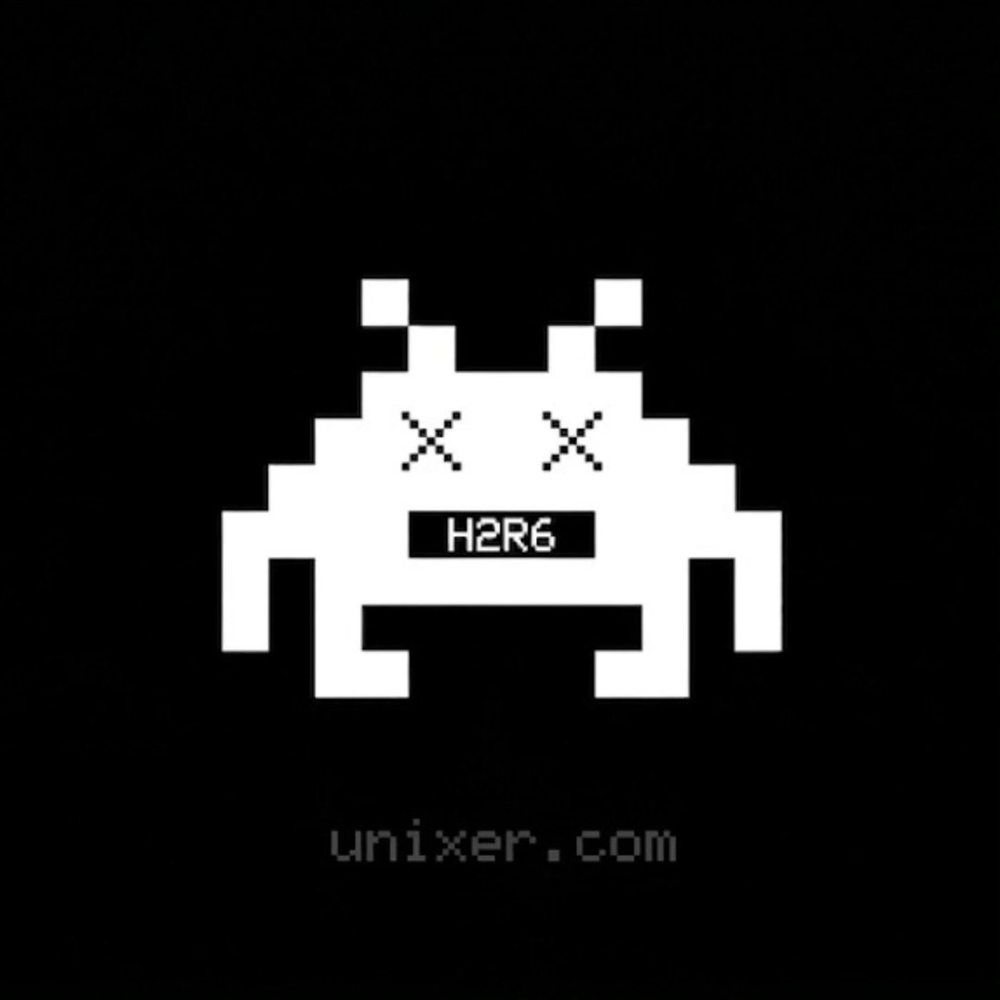

# LYCHI3 CTF — Writeups

**Network & Web** · Formato de bandera: `AHAU{...}`

---

## 📑 Retos

### 🌐 Network

| Reto | Pts | Vulnerabilidad | CWE | Writeup |
|---|:-:|---|---|:-:|
| File transfer | 50 | FTP anónimo | CWE-1188 | [📄](network/file-transfer/README.md) |
| Insecure shell | 100 | Telnet auth bypass (CVE-2026-24061) | CWE-88 | [📄](network/insecure-shell/README.md) |

### 🕸️ Web

| Reto | Pts | Vulnerabilidad | CWE | Writeup |
|---|:-:|---|---|:-:|
| SimplePanel | 100 | SQL Injection (auth bypass) | CWE-89 | [📄](web/simplepanel/README.md) |
| Development | 100 | `.git` expuesto + secretos en historial | CWE-527 | [📄](web/development/README.md) |
| Development 2 | 300 | Backup expuesto con autoindex | CWE-548 | [📄](web/development-2/README.md) |
| Apuntes | 100 | Secreto en cookie Base64 | CWE-315 | [📄](web/apuntes-1/README.md) |
| Apuntes 2 | 100 | Cookie tampering → admin | CWE-565 | [📄](web/apuntes-2/README.md) |
| Apuntes 3 | 100 | IDOR | CWE-639 | [📄](web/apuntes-3/README.md) |
| Apuntes 4 | 300 | OS Command Injection | CWE-78 | [📄](web/apuntes-4/README.md) |
| Apuntes 5 | 300 | LFI / Path Traversal | CWE-22 | [📄](web/apuntes-5/README.md) |

---

## 📋 Resumen

Se resolvieron **10 retos** (1550 puntos) del CTF de **Lychi3**. Casi todas las vulnerabilidades encontradas son **errores de configuración y de validación de entrada**, no fallas complejas:

- Servicios heredados con valores por defecto inseguros (FTP anónimo, Telnet).
- Artefactos de desarrollo publicados en producción (`.git`, backups con `autoindex`).
- Confianza en datos del cliente (cookie sin firma usada para decidir el rol y el objeto a mostrar).
- Input del usuario concatenado en SQL, en comandos de shell y en rutas de archivo.

La serie **Apuntes** es una cadena completa sobre una sola aplicación Flask: cookie legible → admin → IDOR → RCE → LFI → código fuente.

## 🧭 Metodología

1. **Reconocimiento:** escaneo de puertos (`nmap -Pn`), banners, cabeceras HTTP y enumeración de rutas.
2. **Análisis:** identificar la tecnología (Flask, nginx, vsftpd, telnetd) y formular hipótesis a partir de la descripción del reto.
3. **Explotación:** pruebas manuales con `curl` y scripts cortos en bash/Python, documentando también los intentos fallidos.
4. **Post-explotación:** leer el código fuente y la configuración para entender la causa raíz.
5. **Remediación:** propuesta de corrección con código para cada hallazgo.

## 🛠️ Entorno y herramientas

| Herramienta | Versión | Uso |
|---|---|---|
| Garuda Linux | kernel 7.2.9-zen | Sistema atacante |
| nmap | 7.991 | Escaneo de puertos y servicios |
| curl | — | Peticiones HTTP, payloads, cookies |
| ftp / telnet | — | Clientes de los servicios de red |
| git-dumper | 1.0.9 | Reconstrucción del repositorio `.git` |
| flask-unsign | 1.2.1 | Análisis de cookies de sesión Flask |
| hydra | 9.7 | Intento de fuerza bruta en Telnet |
| Python | 3.14.7 | Forja de cookies y scripts auxiliares |

## 🏴 Banderas

| Reto | Flag |
|---|---|
| File transfer | `AHAU{d1s4bl3_4n0n1m0us_us3r}` |
| Insecure shell | `AHAU{wh0_st1ll_us3s_t3ln3t?}` |
| SimplePanel | `AHAU{n1c3_s1mpl3_4uth_byp4ss}` |
| Development | `AHAU{n3v3r_3xp0s3_a_d0t_git}` |
| Development 2 | `AHAU{y0u_4r3_such_a_g00d_d3v}` |
| Apuntes | `AHAU{g00d_eye_l00k1ng_th3_c00k1e}` |
| Apuntes 2 | `AHAU{n3v3r_f0rg3t_th3_s1gn4tur3}` |
| Apuntes 3 | `AHAU{just_a_s1mpl3_idor}` |
| Apuntes 4 | `AHAU{w0w_y0u_1nj3ct3d_a_c0mm4nd}` |
| Apuntes 5 | `AHAU{lfi_4r3_d4ng3r0us_guys}` |

## 📚 Referencias

- OWASP Top 10 (2021): https://owasp.org/Top10/
- MITRE CWE: https://cwe.mitre.org/
- SafeBreach Labs — CVE-2026-24061: https://www.safebreach.com/blog/safebreach-labs-root-cause-analysis-and-poc-exploit-for-cve-2026-24061/
- git-dumper: https://github.com/arthaud/git-dumper
- flask-unsign: https://github.com/Paradoxis/Flask-Unsign

## ⚠️ Disclaimer

Este material es educativo. Todas las técnicas se aplicaron sobre la infraestructura del CTF, que fue diseñada para ser atacada. No uses estas técnicas contra sistemas sin autorización.

---

**H2R6** · [unixer.com](https://unixer.com)

`>_ keep hacking`

